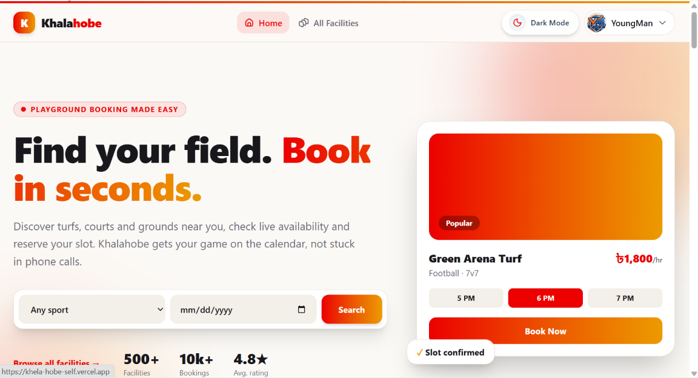
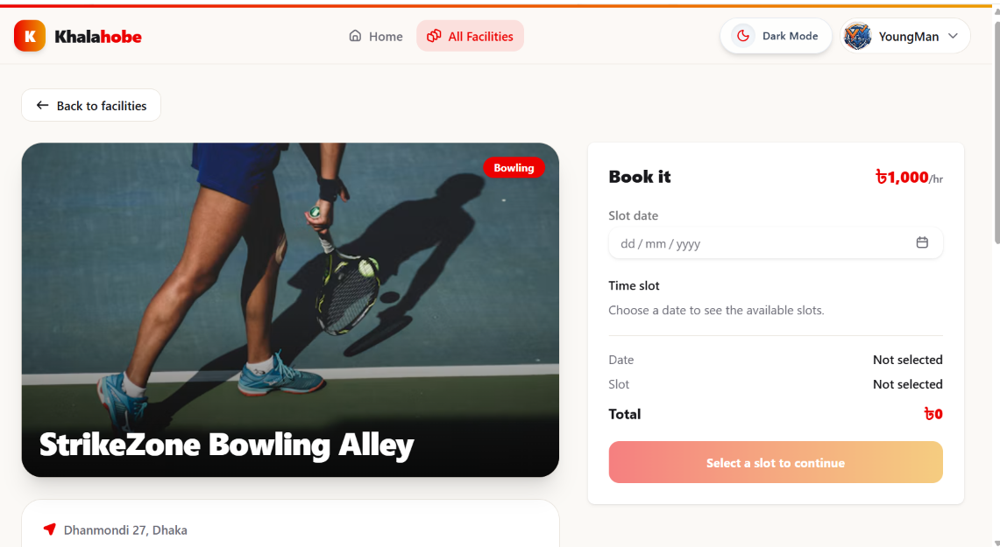
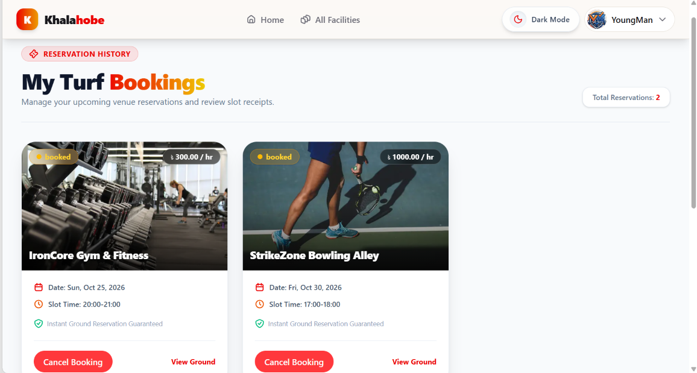

# Khalahobe

**A playground and sports facility booking platform.** Players find grounds, courts and studios, pick a date and a time slot, and book online. Owners list their facilities, set their own price and hours, and manage them from one place.

**Live demo:** [https://khela-hobe-self.vercel.app/](https://khela-hobe-self.vercel.app/)

---

## Features

**For players**
- Browse all facilities and see the most popular ones on the home page
- Facility detail page with photo, price, capacity, location and description
- Book by choosing a date, then one of the owner's available time slots
- Slots that are already booked or in the past cannot be selected
- Sign up and log in with email and password, or with Google
- View your bookings in one place

**For facility owners**
- Add a facility with a photo, price per hour, capacity, description and time slots
- Photos are uploaded and hosted on imgbb
- Time slots are saved as a list (for example `06:00-07:00`) so players can only book hours you offer
- Manage your own facilities, with edit and delete controls shown only to the owner

**General**
- Light and dark mode
- Fully responsive, from phones to large screens
- SEO-ready: page metadata, Open Graph tags, structured data and semantic HTML
- Accessible: keyboard navigation, labelled form fields and a skip link
- Custom 404 and error pages

---

## Tech stack

| Area | Tools |
|---|---|
| Frontend | Next.js (App Router), React, Tailwind CSS |
| UI | HeroUI, Gravity UI icons, React Icons, Framer Motion |
| Authentication | Better Auth (email and password, Google) |
| Backend | Node.js REST API |
| Database | MongoDB |
| Image hosting | imgbb |
| Notifications | React Toastify |
| Deployment | Vercel |

---

## Getting started

### 1. Clone the repository

```bash
git clone https://github.com/halimaashu/khela-hobe
cd khela-hobe
```

### 2. Install dependencies

```bash
npm install
```

### 3. Add environment variables

Create a `.env.local` file in the project root:

```env
# URL of the backend API (no trailing slash)
NEXT_PUBLIC_SERVER_URL=http://localhost:5000

# Free API key from https://api.imgbb.com
NEXT_PUBLIC_IMGBB_API_KEY=your_imgbb_key

# Better Auth
BETTER_AUTH_SECRET=your_long_random_secret
BETTER_AUTH_URL=http://localhost:3000

# Google sign in
GOOGLE_CLIENT_ID=your_google_client_id
GOOGLE_CLIENT_SECRET=your_google_client_secret

# Database connection used by Better Auth
MONGODB_URI=your_mongodb_connection_string
```

### 4. Run the development server

```bash
npm run dev
```

Open [http://localhost:3000](http://localhost:3000) in your browser.

---

## How booking works

1. The player opens a facility and picks a **date**.
2. The page shows only the **time slots the owner added** for that facility.
3. Slots already taken on that date, and slots that have passed today, are disabled.
4. The player confirms, and the booking is saved with the facility, date, slot and price.
5. The server rejects a second booking for the same facility, date and slot.

---

## Project structure

```text
app/
  page.jsx               Home page
  all-facility/          Browse and detail pages
  add-facility/          Add a facility (owners)
  manage-facilities/     Owner dashboard
  bookings/              A user's bookings
  login/  signup/        Authentication pages
  not-found.jsx          Custom 404
  error.jsx              Error page
components/              Navbar, Banner, Featured, BookingCard, Footer and more
lib/                     Auth setup and helpers
```

---

## Screenshots

| Home page | Facility details |
|---|---|
|  |  |



---

## Contact

**Ashikur**

- Email: [halima520ashu@gmail.com](mailto:halima520ashu@gmail.com)
- WhatsApp / Phone: [+880 1975-665249](https://wa.me/8801975665249)
- LinkedIn: [linkedin.com/in/ashkrahman](https://www.linkedin.com/in/ashkrahman/)
- Live project: [khela-hobe-self.vercel.app](https://khela-hobe-self.vercel.app/)

---

If you like this project, please give it a star.